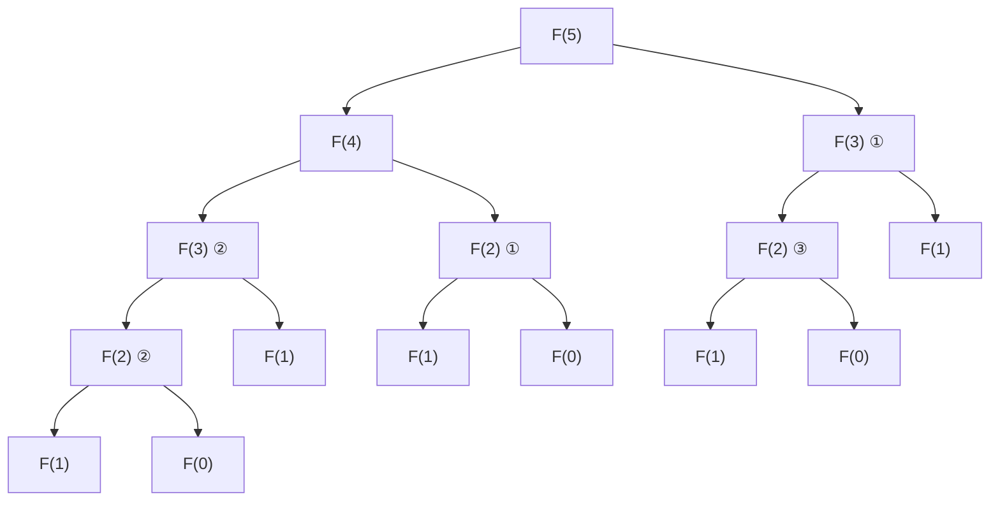
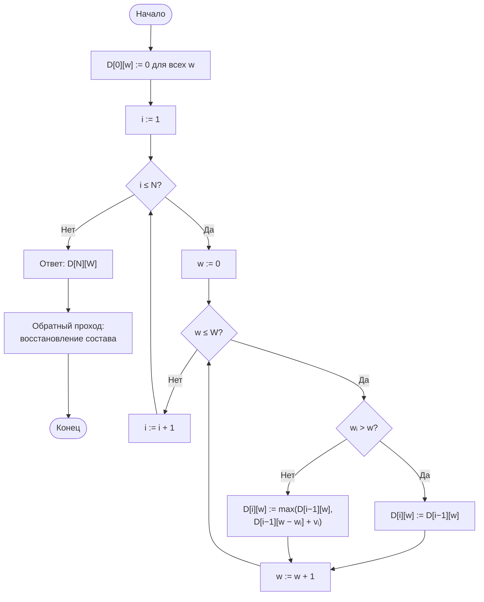

# Лабораторная работа № 7

## Рекурсивные алгоритмы и динамическое программирование в задачах комбинаторной оптимизации

**Дисциплина:** Теория алгоритмов
**Направление подготовки:** 38.03.05 «Бизнес-информатика»
**Курс:** 2
**Объём:** 4 академических часа
**Язык реализации:** Python 3.10+
**Предварительные требования:** ЛР № 3 (рекурсия, парадигма «разделяй и властвуй»)

---

## 1. Цель и задачи работы

**Цель работы:** изучить метод динамического программирования как способ устранения повторных вычислений в рекурсивных алгоритмах и экспериментально сопоставить трудоёмкость трёх реализаций одной задачи — наивной рекурсивной, рекурсивной с мемоизацией и итеративной.

**Задачи:**

1. Изучить понятия дерева рекурсии, перекрывающихся подзадач и оптимальной подструктуры.
2. Реализовать заданную задачу тремя способами и подсчитать число вызовов функции.
3. Измерить время работы всех реализаций и определить предельный размер задачи для наивной рекурсии.
4. Решить задачу дискретной оптимизации (о рюкзаке или о размене) методом динамического программирования.
5. Восстановить оптимальное решение, а не только значение целевой функции.

---

## 2. Теоретическая часть

### 2.1. Рекурсия и дерево рекурсии

Рекурсивный алгоритм сводит задачу к подзадачам того же вида и содержит базовый случай, при котором рекурсия прекращается. Порядок вызовов удобно изображать **деревом рекурсии**, где узел — вызов функции, а потомки — порождённые им вызовы.

Число узлов дерева равно числу вызовов, то есть трудоёмкости алгоритма. Для чисел Фибоначчи

$$F(n) = F(n-1) + F(n-2), \qquad F(0) = 0,\ F(1) = 1,$$

наивная рекурсия порождает дерево, в котором число вызовов растёт как

$$T(n) = \Theta(\varphi^n), \qquad \varphi = \frac{1 + \sqrt{5}}{2} \approx 1{,}618.$$

Это **экспоненциальный** рост: при увеличении $n$ на единицу время увеличивается примерно в 1,6 раза.

### 2.2. Перекрывающиеся подзадачи

Причина экспоненциального роста в том, что одни и те же подзадачи решаются многократно. Например, при вычислении $F(5)$ значение $F(2)$ вычисляется трижды, $F(1)$ — пять раз.

Различие с парадигмой «разделяй и властвуй» из ЛР № 3 принципиально:

| Признак | Разделяй и властвуй | Динамическое программирование |
|---|---|---|
| Подзадачи | Независимы, не повторяются | Перекрываются, повторяются многократно |
| Приём | Рекурсивное деление | Сохранение решённых подзадач |
| Пример | Сортировка слиянием | Задача о рюкзаке, числа Фибоначчи |

### 2.3. Условия применимости динамического программирования

Метод применим, если задача обладает двумя свойствами [1]:

1. **Оптимальная подструктура.** Оптимальное решение задачи содержит в себе оптимальные решения подзадач.
2. **Перекрывающиеся подзадачи.** Общее число различных подзадач невелико (полиномиально), но каждая встречается многократно.

### 2.4. Две формы реализации

**Нисходящая форма (мемоизация).** Сохраняется естественная рекурсивная запись, но результаты вызовов кэшируются в словаре. Если подзадача уже решена, её результат берётся из кэша.

**Восходящая форма (табличная).** Подзадачи решаются в порядке возрастания размера, результаты заполняют таблицу. Рекурсия отсутствует, поэтому нет ограничения на глубину стека.

| Форма | Преимущества | Недостатки |
|---|---|---|
| Нисходящая | Близка к исходной рекурсии; решаются только нужные подзадачи | Накладные расходы на вызовы; ограничение глубины рекурсии |
| Восходящая | Быстрее; допускает оптимизацию памяти | Требует продумать порядок заполнения таблицы |

Для чисел Фибоначчи обе формы дают $\Theta(n)$ операций, а итеративная версия с двумя переменными использует $O(1)$ памяти.

### 2.5. Задача о рюкзаке (0/1)

Дано $N$ предметов; предмет $i$ имеет вес $w_i$ и ценность $v_i$. Вместимость рюкзака равна $W$. Требуется выбрать подмножество предметов максимальной суммарной ценности при ограничении по весу:

$$\max \sum_{i \in S} v_i \quad \text{при} \quad \sum_{i \in S} w_i \le W.$$

**Полный перебор** рассматривает все $2^N$ подмножеств: при $N = 30$ это уже более миллиарда вариантов.

**Рекуррентное соотношение.** Пусть $D[i][w]$ — максимальная ценность, достижимая при использовании первых $i$ предметов и вместимости $w$. Тогда

$$D[i][w] = \begin{cases} D[i-1][w], & w_i > w, \\[4pt] \max\bigl(D[i-1][w],\ D[i-1][w - w_i] + v_i\bigr), & w_i \le w. \end{cases}$$

Ответ находится в $D[N][W]$. Трудоёмкость составляет $\Theta(NW)$, память — $\Theta(NW)$ или $\Theta(W)$ при хранении двух строк таблицы.

**Псевдополиномиальность.** Оценка $\Theta(NW)$ линейна по числовому значению $W$, но экспоненциальна относительно **длины записи** этого числа. Поэтому задача остаётся NP-трудной, а метод эффективен лишь при умеренных $W$.

**Восстановление решения.** Само множество предметов находится обратным проходом по таблице: если $D[i][w] \ne D[i-1][w]$, предмет $i$ включён в решение, и далее рассматривается $D[i-1][w - w_i]$.

### 2.6. Задача о размене суммы

Дана система номиналов $c_1, \ldots, c_k$ и сумма $S$. Требуется набрать $S$ минимальным числом монет:

$$D[s] = 1 + \min_{c_j \le s} D[s - c_j], \qquad D[0] = 0.$$

Трудоёмкость $\Theta(kS)$. Эта задача используется в ЛР № 8 для сравнения с жадным алгоритмом.

---

## 3. Порядок выполнения работы

1. Изучить теоретическую часть.
2. Реализовать задачу А своего варианта (табл. 1) тремя способами: наивная рекурсия, мемоизация, итеративное решение. Реализации должны подсчитывать число вызовов функции.
3. Построить дерево рекурсии для малого значения параметра (не более 5–6 уровней) и указать на нём повторяющиеся подзадачи.
4. Измерить время всех трёх реализаций при возрастающем параметре. Определить значение, при котором наивная реализация перестаёт завершаться за разумное время (ориентир — 10 с).
5. Реализовать задачу Б своего варианта методом динамического программирования, вывести значение целевой функции и **восстановить** оптимальное решение.
6. Для малых размерностей сверить результат ДП с полным перебором.
7. Выполнить дополнительное задание и оформить отчёт.

---

## 4. Варианты заданий

**Таблица 1. Исходные данные**

| № | Задача А (три реализации) | Параметр $n$ | Задача Б (ДП) | Данные задачи Б | Доп. |
|---|---|---|---|---|---|
| 0 | Числа Фибоначчи | 10…32 | Рюкзак 0/1 | $N = 20$, $W = 100$ | — |
| 1 | Число способов подняться по лестнице (шаги 1, 2) | 10…30 | Размен суммы | $S = 137$, номиналы 1, 5, 10, 25 | Г1 |
| 2 | Числа Фибоначчи | 10…32 | Рюкзак 0/1 | $N = 25$, $W = 150$ | Г2 |
| 3 | Число путей в сетке $m \times n$ | до $12 \times 12$ | Наибольшая общая подпоследовательность | Строки длиной 200 | Г3 |
| 4 | Лестница с шагами 1, 2, 3 | 10…28 | Размен суммы | $S = 200$, номиналы 1, 3, 7 | Г4 |
| 5 | Числа Фибоначчи | 10…33 | Рюкзак 0/1 | $N = 22$, $W = 120$ | Г5 |
| 6 | Биномиальный коэффициент $C(n, k)$ | $n$ до 28 | Максимальная сумма подотрезка | Массив из 10 000 чисел | Г6 |
| 7 | Число путей в сетке с препятствиями | до $12 \times 12$ | Рюкзак 0/1 | $N = 20$, $W = 200$ | Г7 |
| 8 | Числа Фибоначчи | 10…32 | Размен суммы | $S = 99$, номиналы 1, 2, 5, 10 | Г1 |
| 9 | Лестница с шагами 1, 2 | 10…30 | Наибольшая возрастающая подпоследовательность | Массив из 2000 чисел | Г2 |
| 10 | Биномиальный коэффициент | $n$ до 26 | Рюкзак 0/1 | $N = 24$, $W = 100$ | Г3 |
| 11 | Числа Фибоначчи | 10…31 | Размен суммы | $S = 250$, номиналы 1, 4, 6, 9 | Г4 |
| 12 | Число разбиений числа на слагаемые | до 40 | Рюкзак 0/1 | $N = 20$, $W = 80$ | Г5 |
| 13 | Лестница с шагами 1, 2, 3 | 10…27 | Редакционное расстояние | Строки длиной 300 | Г6 |
| 14 | Числа Фибоначчи | 10…32 | Размен суммы | $S = 180$, номиналы 1, 5, 12 | Г7 |
| 15 | Число путей в сетке | до $13 \times 13$ | Рюкзак 0/1 | $N = 21$, $W = 140$ | Г1 |
| 16 | Биномиальный коэффициент | $n$ до 27 | Размен суммы | $S = 120$, номиналы 1, 2, 5, 20 | Г2 |
| 17 | Числа Фибоначчи | 10…32 | Наибольшая общая подпоследовательность | Строки длиной 250 | Г3 |
| 18 | Лестница с шагами 1, 2 | 10…30 | Рюкзак 0/1 | $N = 23$, $W = 160$ | Г4 |
| 19 | Число разбиений числа | до 38 | Размен суммы | $S = 300$, номиналы 1, 7, 11 | Г5 |
| 20 | Числа Фибоначчи | 10…33 | Задача о расписании работ с прибылью | 15 работ | Г6 |
| 21 | Число путей в сетке с препятствиями | до $12 \times 12$ | Рюкзак 0/1 | $N = 20$, $W = 90$ | Г7 |
| 22 | Биномиальный коэффициент | $n$ до 28 | Размен суммы | $S = 145$, номиналы 1, 3, 5, 10 | Г1 |
| 23 | Лестница с шагами 1, 2, 3 | 10…28 | Максимальная сумма подотрезка | Массив из 20 000 чисел | Г2 |
| 24 | Числа Фибоначчи | 10…32 | Рюкзак 0/1 | $N = 26$, $W = 110$ | Г3 |
| 25 | Число разбиений числа | до 40 | Размен суммы | $S = 210$, номиналы 1, 6, 13 | Г4 |
| 26 | Число путей в сетке | до $13 \times 13$ | Редакционное расстояние | Строки длиной 400 | Г5 |
| 27 | Числа Фибоначчи | 10…31 | Рюкзак 0/1 | $N = 22$, $W = 130$ | Г6 |
| 28 | Биномиальный коэффициент | $n$ до 26 | Размен суммы | $S = 165$, номиналы 1, 2, 9, 15 | Г7 |
| 29 | Лестница с шагами 1, 2 | 10…30 | Наибольшая возрастающая подпоследовательность | Массив из 3000 чисел | Г1 |
| 30 | Числа Фибоначчи и лестница | 10…32 | Рюкзак 0/1 и размен | $N = 20$, $W = 100$; $S = 137$ | Г3 |

**Таблица 2. Дополнительные задания**

| Код | Содержание |
|---|---|
| Г1 | Построить график числа вызовов функции от $n$ для наивной и мемоизированной версий (логарифмическая шкала). Оценить основание экспоненты по наклону прямой |
| Г2 | Реализовать ДП с **оптимизацией памяти** (две строки таблицы или одномерный массив). Измерить расход памяти в обоих вариантах |
| Г3 | Сверить результат ДП с **полным перебором** для $N \le 20$ на 100 случайных наборах данных. Подтвердить совпадение оптимумов |
| Г4 | Исследовать зависимость времени ДП от $W$ (или $S$) при фиксированном $N$. Подтвердить линейность и пояснить понятие псевдополиномиальности |
| Г5 | Реализовать **восстановление решения** двумя способами: обратным проходом по таблице и хранением выбора в отдельной таблице. Сравнить расход памяти |
| Г6 | Сравнить собственную мемоизацию с декоратором `functools.lru_cache`. Объяснить разницу во времени |
| Г7 | Сформулировать и решить прикладную задачу: отбор проектов в портфель при ограниченном бюджете. Построить график зависимости прибыли портфеля от бюджета |

---

## 5. Требования к отчёту

1. Титульный лист.
2. Цель работы и задание варианта.
3. Рекуррентные соотношения обеих задач с пояснением каждого слагаемого.
4. Дерево рекурсии для малого параметра с отмеченными повторяющимися подзадачами.
5. Блок-схема или схема заполнения таблицы ДП.
6. Листинг программы.
7. Таблицы измерений (время и число вызовов) и графики.
8. Оптимальное решение задачи Б с расшифровкой (какие предметы, какие монеты).
9. Выводы.

---

## 6. Пример оформления отчёта (вариант 0)

### 6.1. Задание

Реализовать вычисление чисел Фибоначчи тремя способами, сравнить время и число вызовов. Решить задачу о рюкзаке 0/1 при $N = 20$, $W = 100$ методом динамического программирования, сверить с полным перебором и восстановить состав рюкзака.

### 6.2. Дерево рекурсии для $F(5)$



Подзадача $F(3)$ решается дважды, $F(2)$ — трижды, $F(1)$ — пять раз. При мемоизации каждая подзадача вычисляется ровно один раз, и дерево превращается в цепочку из $n$ вызовов.

### 6.3. Схема заполнения таблицы задачи о рюкзаке



### 6.4. Листинг программы

```python
"""
Лабораторная работа № 7. Вариант 0.
Числа Фибоначчи: три реализации. Задача о рюкзаке 0/1: ДП и полный перебор.
"""
import random
import time
from itertools import combinations

calls = 0          # счётчик вызовов рекурсивной функции


def fib_naive(n):
    """Наивная рекурсия: Θ(φⁿ)."""
    global calls
    calls += 1
    if n < 2:
        return n
    return fib_naive(n - 1) + fib_naive(n - 2)


def fib_memo(n, cache=None):
    """Нисходящее ДП (мемоизация): Θ(n)."""
    global calls
    calls += 1
    if cache is None:
        cache = {}
    if n < 2:
        return n
    if n in cache:
        return cache[n]
    cache[n] = fib_memo(n - 1, cache) + fib_memo(n - 2, cache)
    return cache[n]


def fib_iter(n):
    """Восходящее ДП: Θ(n) времени, O(1) памяти."""
    a, b = 0, 1
    for _ in range(n):
        a, b = b, a + b
    return a


def knapsack_dp(weights, values, capacity):
    """Задача о рюкзаке 0/1. Возвращает (ценность, список индексов предметов)."""
    n = len(weights)
    D = [[0] * (capacity + 1) for _ in range(n + 1)]
    for i in range(1, n + 1):
        wi, vi = weights[i - 1], values[i - 1]
        for w in range(capacity + 1):
            D[i][w] = D[i - 1][w]
            if wi <= w and D[i - 1][w - wi] + vi > D[i][w]:
                D[i][w] = D[i - 1][w - wi] + vi

    # обратный проход: восстановление состава рюкзака
    chosen, w = [], capacity
    for i in range(n, 0, -1):
        if D[i][w] != D[i - 1][w]:
            chosen.append(i - 1)
            w -= weights[i - 1]
    return D[n][capacity], sorted(chosen)


def knapsack_brute(weights, values, capacity):
    """Полный перебор: 2^N подмножеств. Только для проверки при малых N."""
    n = len(weights)
    best, best_set = 0, ()
    for size in range(n + 1):
        for subset in combinations(range(n), size):
            w = sum(weights[i] for i in subset)
            if w <= capacity:
                v = sum(values[i] for i in subset)
                if v > best:
                    best, best_set = v, subset
    return best, list(best_set)


if __name__ == "__main__":
    # --- Часть 1. Числа Фибоначчи ---
    print(f"{'n':>4} {'наивная, с':>12} {'вызовов':>12} {'мемо, с':>10}"
          f" {'вызовов':>9} {'итер., с':>10} {'F(n)':>12}")
    for n in [10, 20, 25, 30, 32]:
        calls = 0
        t0 = time.perf_counter(); r1 = fib_naive(n); t_naive = time.perf_counter() - t0
        c_naive = calls

        calls = 0
        t0 = time.perf_counter(); r2 = fib_memo(n); t_memo = time.perf_counter() - t0
        c_memo = calls

        t0 = time.perf_counter(); r3 = fib_iter(n); t_iter = time.perf_counter() - t0
        assert r1 == r2 == r3
        print(f"{n:>4} {t_naive:>12.4f} {c_naive:>12} {t_memo:>10.6f}"
              f" {c_memo:>9} {t_iter:>10.6f} {r1:>12}")

    # --- Часть 2. Задача о рюкзаке ---
    N, W = 20, 100
    rng = random.Random(7)
    weights = [rng.randint(5, 40) for _ in range(N)]
    values = [rng.randint(10, 100) for _ in range(N)]

    t0 = time.perf_counter(); v_dp, items_dp = knapsack_dp(weights, values, W)
    t_dp = time.perf_counter() - t0
    t0 = time.perf_counter(); v_bf, items_bf = knapsack_brute(weights, values, W)
    t_bf = time.perf_counter() - t0

    print(f"\nРюкзак: N = {N}, W = {W}")
    print(f"  ДП:              ценность {v_dp}, время {t_dp:.4f} с")
    print(f"  Полный перебор:  ценность {v_bf}, время {t_bf:.4f} с")
    print(f"  Ускорение: в {t_bf / t_dp:.0f} раз")
    print(f"  Состав рюкзака (ДП): предметы {items_dp}")
    print(f"  Суммарный вес: {sum(weights[i] for i in items_dp)} из {W}")
    assert v_dp == v_bf, "Результаты ДП и перебора не совпадают"
```

### 6.5. Результаты

Измерения выполнены в среде Linux, Python 3.12.

**Таблица 3. Три реализации чисел Фибоначчи**

| $n$ | Наивная, с | Вызовов | Мемоизация, с | Вызовов | Итеративная, с | $F(n)$ |
|---|---|---|---|---|---|---|
| 10 | 0,0000 | 177 | 0,000005 | 19 | 0,000002 | 55 |
| 20 | 0,0017 | 21 891 | 0,000008 | 39 | 0,000002 | 6765 |
| 25 | 0,0150 | 242 785 | 0,000010 | 49 | 0,000002 | 75 025 |
| 30 | 0,1745 | 2 692 537 | 0,000018 | 59 | 0,000005 | 832 040 |
| 32 | 0,4075 | 7 049 155 | 0,000036 | 63 | 0,000005 | 2 178 309 |

Число вызовов наивной версии при переходе от $n = 30$ к $n = 32$ выросло в 2,62 раза, то есть примерно в $\varphi^2 = 2{,}618$ раза. Это прямое подтверждение оценки $\Theta(\varphi^n)$. Число вызовов мемоизированной версии равно $2n - 1$.

**Таблица 4. Задача о рюкзаке ($N = 20$, $W = 100$)**

| Метод | Ценность | Время, с | Число рассмотренных состояний |
|---|---|---|---|
| Динамическое программирование | 565 | 0,0002 | $NW = 2000$ |
| Полный перебор | 565 | 0,5403 | $2^{20} = 1\,048\,576$ |

Ускорение составило около 2600 раз. Оптимальный состав: предметы с номерами 1, 3, 4, 6, 8, 10, 12, 15, 17 (нумерация с нуля), суммарный вес 97 из 100.

### 6.6. Выводы (образец)

1. Наивная рекурсия демонстрирует экспоненциальный рост: при увеличении $n$ на 1 число вызовов растёт примерно в 1,6 раза, что соответствует теоретической оценке $\Theta(\varphi^n)$. При $n = 32$ требуется свыше семи миллионов вызовов.
2. Мемоизация сокращает число вызовов до $2n - 1$, то есть сложность снижается с экспоненциальной до линейной. Это достигается ценой $\Theta(n)$ дополнительной памяти под кэш — типичный размен «память против времени».
3. Итеративная версия быстрее мемоизированной, так как не тратит время на вызовы функций и хранение кэша, и требует лишь $O(1)$ памяти.
4. Для задачи о рюкзаке динамическое программирование при $N = 20$, $W = 100$ даёт тот же оптимум, что и полный перебор, но на порядки быстрее: $\Theta(NW) = 2000$ ячеек таблицы против $2^{20} \approx 10^6$ подмножеств.
5. Практический смысл: задача отбора проектов в портфель при ограниченном бюджете имеет ту же структуру, что и задача о рюкзаке, и потому решается точно, а не перебором вариантов вручную.

---

## 7. Контрольные вопросы

1. Что такое дерево рекурсии? Как по нему оценить трудоёмкость алгоритма?
2. Почему наивное вычисление чисел Фибоначчи экспоненциально, хотя ответ вычисляется за $\Theta(n)$ операций итеративно?
3. Сформулируйте два условия применимости динамического программирования.
4. Чем динамическое программирование отличается от парадигмы «разделяй и властвуй»?
5. В чём различие нисходящей и восходящей форм? Каковы преимущества каждой?
6. Запишите рекуррентное соотношение задачи о рюкзаке и поясните смысл каждой ветви.
7. Почему сложность $\Theta(NW)$ называется псевдополиномиальной?
8. Как восстановить состав оптимального решения по таблице ДП?
9. Как сократить память в задаче о рюкзаке до $\Theta(W)$? Что при этом теряется?
10. Приведите пример задачи управления, сводящейся к задаче о рюкзаке.

---

## 8. Рекомендуемая литература

1. Кормен Т., Лейзерсон Ч., Ривест Р., Штайн К. Алгоритмы: построение и анализ. — 3-е изд. — М.: Вильямс, 2013. — Гл. 15.
2. Рафгарден Т. Совершенный алгоритм. Жадные алгоритмы и динамическое программирование. — СПб.: Питер, 2020.
3. Скиена С. Алгоритмы. Руководство по разработке. — 3-е изд. — СПб.: БХВ-Петербург, 2022. — Гл. 10.
4. Бхаргава А. Грокаем алгоритмы. — 2-е изд. — СПб.: Питер, 2024. — Гл. 9.
5. Левитин А. Алгоритмы. Введение в разработку и анализ. — М.: Вильямс, 2006.
6. Документация Python: модуль `functools`, декоратор `lru_cache` [Электронный ресурс]. — URL: https://docs.python.org/3/library/functools.html
